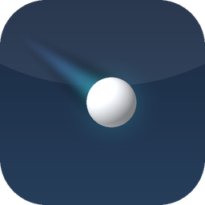

# 图标设计

## 最终图标



**设计**：深海军蓝圆角方块（与 WebUI 配色一致）+ 白色乒乓球 + 青→蓝的彗星拖尾。
拖尾对应产品的核心视觉特色（球速残影），也是名字「乒乓彗星 / TTComet」的由来。

## 文件

| 文件 | 说明 |
|---|---|
| `make_icons.py` | 生成 4 个候选方案（彗星球 / 弧线轨迹 / 球拍+彗星 / 球台+彗星），出 `candidates.png` |
| `make_ico.py` | 生成最终 `.ico`（16/24/32/48/64/128/256 七个尺寸） |
| `candidates.png` | 四个方案的设计记录（含 16/32/48px 可读性对比） |
| `ico_preview.png` | 最终图标各尺寸平铺预览 |
| `ttComet-256.png` | 最终图标 256px 源图 |

生成的图标会同时写入：
- `webui/packaging/ttComet.ico` —— 打包进 exe（PyInstaller `icon=`）与安装包（Inno `SetupIconFile`）
- `webui/app/static/favicon.ico` —— 浏览器标签页

## 关键取舍

- **16/24/32px 用简化版**：球径放大到 50%、尾巴缩短变实。完整版直接缩小会糊成一团，小尺寸下只剩一个白点。
- **光晕用径向渐变逐像素绘制**，不用"椭圆 + 高斯模糊"——后者在贴图边界会被截断，留下方形接缝（v1 踩过）。
- **球用球面着色**（numpy 逐像素法线 + 双向光照），而不是纯色圆 + 高光点，否则缩小后像个平面圆点。

## 重新生成

```powershell
# 只看候选方案（改设计时用）
webui\.venv\Scripts\python.exe webui\design\make_icons.py

# 生成最终 ico（改完 make_ico.py 里的参数后跑）
webui\.venv\Scripts\python.exe webui\design\make_ico.py
```

依赖 Pillow（`pip install pillow`）。
